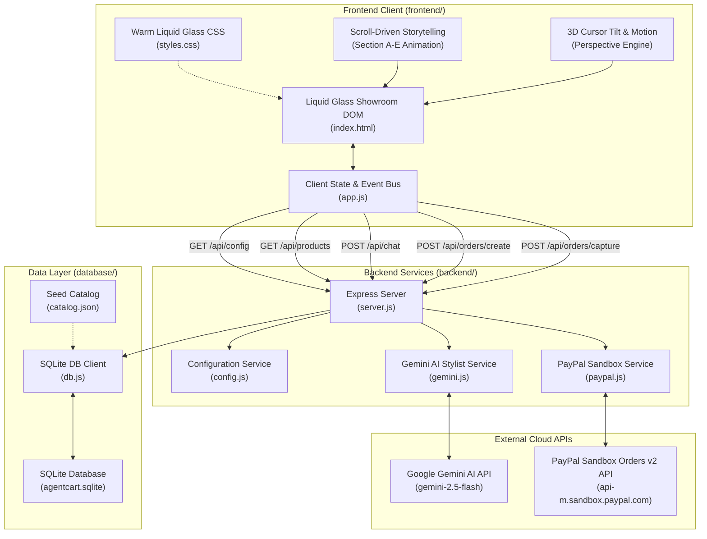

# AgentCart AI — System Architecture & Component Guide

**Version:** 3.1.0 (Clean Architecture & Modular Reorganization Edition)  
**Status:** Verified & Operational  
**Last Updated:** October 29, 2026  

---

## 1. Architectural Overview

AgentCart AI is a high-performance, full-stack e-commerce application designed as a digital showroom for premium technical jackets. It pairs a **Warm Liquid Glass** frontend with an **Express.js** backend, an **SQLite** dual-currency transaction ledger, a **Gemini AI Stylist**, and **PayPal Sandbox Orders v2** checkout.

The project is organized into distinct, decoupled layers:

```
D:\AgentCart-AI\
├── backend\                 # Express REST API & Server Services
│   ├── config.js            # Environment validation & configuration
│   ├── gemini.js            # Google Gemini AI concierge service
│   ├── paypal.js            # PayPal Sandbox Orders v2 client
│   └── server.js            # Express application entry point & routes
│
├── database\                # Data Persistence & Migration Layer
│   ├── agentcart.sqlite     # SQLite database file (catalog, orders, ledger)
│   ├── catalog.json         # Master 24-jacket product seed definitions
│   ├── db.js                # SQLite access layer (better-sqlite3)
│   ├── schema.sql           # Database schema definition
│   └── seed.js              # Database initialization & seeding script
│
├── frontend\                # Client Browser Application & Assets
│   ├── index.html           # Single-page digital showroom DOM structure
│   ├── styles.css           # Warm Liquid Glass design system & 3D styling
│   ├── app.js               # Reactive client state, scroll motion & event bus
│   └── assets\
│       └── images\
│           └── jackets\     # 24 high-resolution transparent jacket renders
│
├── tests\                   # Automated Test Suite & Fixtures
│   └── run_tests.js         # 29-test end-to-end integration & unit runner
│
├── docs\                    # Project & Architecture Documentation
│   └── ARCHITECTURE.md      # This architectural specification
│
├── video\                   # Reference Materials
│   ├── extracted_frames\    # 30 OpenCV-extracted visual design frames
│   └── *.mp4                # Original reference showroom recording
│
├── scripts\                 # Development & asset transformation utilities
├── package.json             # NPM package scripts & dependencies
├── package-lock.json        # Pinned dependency tree
├── .env.example             # Clean environment template (no secrets)
├── .gitignore               # Strict version control ignore rules
├── README.md                # Project introduction & quick-start
├── PROJECT_STATE.md         # Milestone tracking & platform state
└── HANDOFF.md               # Operational handoff & verification logs
```

---

## 2. Component Interaction & Data Flow



---

## 3. Detailed Component Responsibilities

### 3.1 Frontend (`frontend/`)
- **`index.html`**:
  - Restrained technical header with monospace navigation and live `CART [ 0 ]` tracker.
  - **Section A**: Cinematic Flagship Product Hero featuring technical corner bracket callouts (`┌ ┐ └ ┘`), EST.2022 globe badge, and responsive floating tilt.
  - **Section B ("DETAILS MATTER.")**: Parallax jacket view with 5 verified technical specification rows.
  - **Section C ("COLLECTIONS")**: 4-card curated showroom grid + gateway to the full 24-jacket interactive explorer with instant filtering, sorting, and price range controls.
  - **Section D ("TECHNOLOGY ENGINEERED TO ENDURE.")**: 3D exploded 4-layer isometric material stack with scroll-driven elevation and interactive layer inspection.
  - **Section E ("NEED TO KNOW.")**: Sticky collar focus visual with 5 expandable technical FAQ rows.
  - **Footer**: Newsletter drop subscription, technical monospace navigation, and legal disclaimers.
  - Modals: AI Stylist Chat, Side-by-Side Jacket Comparison, Single Product Details, Liquid Glass Cart Drawer, and Dual-Currency PayPal Sandbox Checkout.
- **`styles.css`**:
  - Complete Warm Liquid Glass design system: Warm Ivory (`#FAF8F5`, `#F4EFEB`), Slate Navy (`#1E2530`, `#151D28`), and Laboratory Orange accents (`#E15C1D`).
  - Specular edge highlights (`rgba(255, 255, 255, 0.95)`), 12px–20px backdrop blurs, and fine technical grid canvases.
  - Platform-specific fixes: `-webkit-appearance: none` and `::-ms-expand { display: none; }` to eliminate native black triangle dropdown glitches on Windows.
  - 3D isometric material layer transforms (`translateZ(145px)`, `translateZ(65px)`, etc.).
- **`app.js`**:
  - Cyberpunk text scrambler/decrypt typography engine.
  - Mouse-tracking 3D perspective tilt on the flagship jacket.
  - Bidirectional scroll position observer for Section A-to-B transitions and Section D layer elevation.
  - Shopping cart state persistence, dual-currency calculations, flying item animations, and DOM safeguards.

### 3.2 Backend (`backend/`)
- **`server.js`**:
  - Serves static frontend files from `../frontend` and `/assets` from `../frontend/assets`.
  - Exposes secured REST API endpoints with server-side validation and anti-tamper controls.
  - Graceful port fallback and robust error handling middleware.
- **`config.js`**:
  - Loads and validates environment variables from `.env`.
  - Enforces currency rules and exchange rates (1 USD = 85 INR demonstration rate).
  - Sanitizes public configuration sent to `/api/config` to guarantee zero secret leakage.
- **`gemini.js`**:
  - Wraps Google Gemini API (`@google/genai` or direct REST).
  - Provides system-grounded jacket stylist advice strictly restricted to the 24 database products.
  - Graceful fallback responses when offline or when no API key is configured.
- **`paypal.js`**:
  - Interacts with PayPal Sandbox Orders v2 (`/v2/checkout/orders`).
  - Validates cart line items and recalculated totals against the SQLite database before creating orders.
  - Captures payments and records dual-currency transaction records into SQLite.

### 3.3 Database (`database/`)
- **`db.js`**:
  - SQLite database wrapper using `better-sqlite3`.
  - Manages database connection to `agentcart.sqlite`.
  - Initializes schema automatically on startup if tables are missing.
- **`schema.sql`**:
  - `products`: Product ID, name, slug, category, price_inr, price_usd, rating, review_count, specs, features, colors, image_url.
  - `orders`: Order ID, paypal_order_id, status, total_inr, total_usd, currency, created_at, customer_info.
  - `order_items`: Order foreign key, product_id, quantity, unit_price_inr, unit_price_usd.
- **`catalog.json` & `seed.js`**:
  - 24 technical jackets across 10 distinct categories.
  - Seeding utility that populates or refreshes database records idempotently.

---

## 4. API Endpoints Specification

| Method | Route | Description | Auth / Security |
| :--- | :--- | :--- | :--- |
| `GET` | `/` | Serves `frontend/index.html` digital showroom | Public |
| `GET` | `/styles.css` | Serves Warm Liquid Glass stylesheet | Public |
| `GET` | `/app.js` | Serves client application script | Public |
| `GET` | `/assets/*` | Serves jacket imagery and client assets | Public |
| `GET` | `/api/config` | Returns public client configuration (PayPal client ID, currency, exchange rate) | No secret keys exposed |
| `GET` | `/api/products` | Returns all 24 database products with filters and search support | Public |
| `GET` | `/api/products/:id` | Returns single product details by ID or slug | Public |
| `POST` | `/api/chat` | AI Stylist conversational endpoint | Grounded on database products |
| `POST` | `/api/orders/create` | Creates PayPal Sandbox Order v2 | Server-side price recalculation |
| `POST` | `/api/orders/capture` | Captures approved PayPal payment and writes to SQLite ledger | Strict ID & status validation |

---

## 5. Dual-Currency Accounting & Transaction Safety

1. **Catalog Base Pricing:**
   - Jackets have an official base price in Indian Rupees (`price_inr`) and an equivalent USD price (`price_usd`) calculated via a fixed rate: `1 USD = 85 INR`.
2. **Anti-Tampering Guardrails:**
   - The client never passes prices to `/api/orders/create`.
   - The client passes only `{ items: [{ id: "cyber-shell-black", quantity: 1 }] }`.
   - The server queries `database/db.js` for verified database prices and calculates total amounts server-side.
3. **Transaction Capture & Persistence:**
   - Once captured via PayPal Orders v2, the order is recorded into `database/agentcart.sqlite` with both INR and USD values, timestamp, and line item records.

---

## 6. Testing & Quality Assurance

The automated test runner is located at `tests/run_tests.js`.

To execute the complete test suite:
```powershell
npm test
```

Verification suite checks:
1. **Database & Catalog:** Verifies 24 jackets, categories, images, and schema constraints.
2. **Search, Filter & Sort:** Validates category filtering, pricing sort, and search keyword matching.
3. **Pricing & Tamper Security:** Tests price tampering prevention, empty cart handling, and dual-currency conversion.
4. **AI Stylist Service:** Tests prompt injection resistance and product grounding.
5. **PayPal Checkout Engine:** Tests order creation, sandbox capture mock, and database persistence.
6. **Live HTTP Server:** Boots Express server on an ephemeral port to verify live responses for `/`, `/styles.css`, `/app.js`, `/assets/...`, `/api/config`, and `/api/products`.
